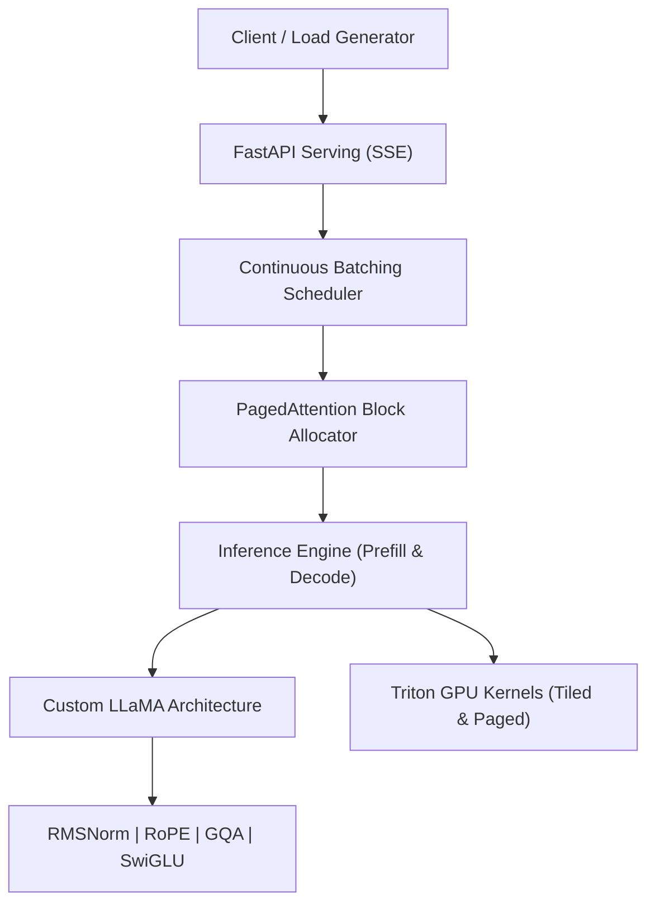

# Mini LLM Inference Engine

An end-to-end LLM inference engine built from scratch in PyTorch, Triton, and FastAPI, designed to demonstrate the inner workings of modern inference engines (such as vLLM, Hugging Face TGI, and TensorRT-LLM).

Built with a step-by-step phased methodology: from raw mathematical primitives (RMSNorm, RoPE, GQA, SwiGLU) up through continuous batching, paged attention, custom GPU kernels, and production serving.

---

## 🎯 Target Reference Models
- **Primary**: `HuggingFaceTB/SmolLM-135M` (and `SmolLM-135M-Instruct`)
- **Secondary**: `TinyLlama/TinyLlama-1.1B`

---

## 🏗️ Architecture & Roadmap



### Roadmap & Phases
- [ ] **Phase 0-1: Naive Inference Baseline**
  - Custom LLaMA architecture from scratch (RMSNorm, RoPE, GQA, SwiGLU).
  - Raw `safetensors` weight loading (no HF forward pass).
  - Sampling strategies (greedy, temperature, top-$k$, top-$p$).
  - Correctness verification against Hugging Face reference.
- [ ] **Phase 2: KV Cache**
  - Decoupled prefill and decode paths.
  - $O(1)$ per-token complexity during autoregressive decode.
  - Verification & speedup benchmarks across sequence lengths (128, 512, 2048).
- [ ] **Phase 3: Static & Continuous Batching**
  - Attention masks, padding, request queue, iteration-level scheduling.
  - Dynamic request lifecycle (`WAITING` $\to$ `RUNNING` $\to$ `FINISHED`).
  - Throughput evaluation at 1, 2, 4, 8, 16 concurrent requests.
- [ ] **Phase 4: Paged Attention**
  - Block allocator (block size 16), physical memory pool, per-request block tables.
  - Page-aware attention kernel in PyTorch.
  - Preemption and memory fragmentation analysis.
- [ ] **Phase 5: Custom Triton Kernels**
  - Tiled attention with online softmax (FlashAttention style).
  - Paged decode attention kernel.
- [ ] **Phase 6: Advanced Feature**
  - *To be selected: INT8 weight-only quantization, chunked prefill, or speculative decoding.*
- [ ] **Phase 7: Production Serving**
  - FastAPI server with Server-Sent Events (SSE) streaming.
  - Async request queue feeding the background scheduler.
- [ ] **Phase 8: Comprehensive Benchmarks vs HF & vLLM**
  - Controlled comparative benchmarks on Kaggle/Colab T4 GPU.

---

## 📁 Repository Structure

```
├── docs/
│   ├── decisions_log.md      # Architectural choices & trade-offs
│   ├── metrics_log.md        # Real benchmark numbers (hardware, settings)
│   ├── bug_log.md            # Post-mortems of encountered bugs
│   ├── glossary.md           # Interview-ready explanations of LLM concepts
│   └── teach-back/           # Comprehensive phase-by-phase interview guides
├── src/
│   └── mini_infer/           # Core inference engine package
├── tests/                    # Pytest verification suites (vs HF reference)
├── benchmarks/               # Reproducible benchmarking scripts
├── notebooks/                # GPU execution notebooks (Kaggle / Colab)
├── requirements.txt
└── README.md
```

---

## 💻 Hardware & Dev Environment
- **Local Development**: Python, PyTorch (CPU-compatible for rapid iteration).
- **GPU Execution & Kernels**: Kaggle / Google Colab (NVIDIA T4).
