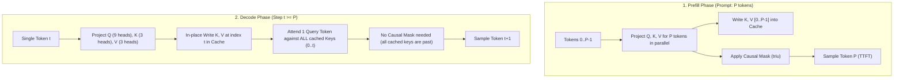

# Phase 2 Teach-Back: Key-Value (KV) Caching & Autoregressive Scaling

Welcome to Phase 2 of the Mini-LLM Inference Engine. In this phase, we transitioned our inference engine from a **naive full-sequence recomputation** baseline ($O(N^2)$ time complexity) into an **optimized Key-Value Cached** engine ($O(N)$ time complexity).

This document breaks down the core concepts, tensor mechanics, memory formulas, GPU profiling observations, and interview preparation questions.

---

## 1. Why Autoregressive Decoding Needs a KV Cache

### The $O(N^2)$ Naive Quadratic Wall
In Phase 0-1, each decode step $t$ passed the full sequence $x_{0:t}$ into all 30 transformer layers:
* Step 1: Forward 1 token $\to$ compute $Q, K, V$ for 1 token.
* Step 2: Forward 2 tokens $\to$ compute $Q, K, V$ for 2 tokens (recomputing token 0).
* Step $N$: Forward $N$ tokens $\to$ compute $Q, K, V$ for $N$ tokens (recomputing tokens $0 \dots N-1$).

Total token evaluations across $N$ decode steps:
$$\sum_{t=1}^{N} t = \frac{N(N + 1)}{2} \approx \frac{N^2}{2} \in O(N^2)$$

At short generation lengths (e.g. 32 tokens), the quadratic overhead is negligible compared to fixed runtime overheads. But at **512 tokens**, naive generation evaluates $\approx 131,072$ tokens, causing throughput on CPU to collapse to **1.00 token/second** and taking over **8.5 minutes**!

### The $O(N)$ Solution: Decoupled Prefill & Decode
Notice that in an autoregressive decoder, past tokens do not change!
* Token 0's Key and Value vectors in Layer 5 are identical whether the sequence has 10 tokens or 1000 tokens.
* Therefore, we only need to compute Key and Value projections **once** per token and store them in memory: the **Key-Value (KV) Cache**.



---

## 2. The RoPE `start_pos` Mechanics

Rotary Position Embedding (RoPE) encodes position by rotating the Query and Key vectors by geometric angles $\theta_i = \text{base}^{-2i/d}$:
$$R_t = \begin{pmatrix} \cos(t\theta_i) & -\sin(t\theta_i) \\ \sin(t\theta_i) & \cos(t\theta_i) \end{pmatrix}$$

### The Decode Bug & The Fix
* In Phase 0-1, the model processed the full sequence from index $0$ to $t$. RoPE simply sliced `cos_cached[:, :, 0:seq_len, :]`.
* In Phase 2 decode, **only 1 token** enters the layer per step (`seq_len = 1`).
* If RoPE sliced `0 : seq_len` (i.e. `0 : 1`), token $t$ would receive angle $\theta_0$ (position 0)! The model would think every new token was the first token of the prompt, corrupting attention.

**The Fix: Explicit `start_pos` Slicing**:
```python
def forward(self, x: torch.Tensor, seq_len: int, start_pos: int = 0):
    end_pos = start_pos + seq_len
    cos = self.cos_cached[:, :, start_pos:end_pos, :]
    sin = self.sin_cached[:, :, start_pos:end_pos, :]
    return cos, sin
```

### Single Query Token Across All 9 Heads
In SmolLM-135M:
* Query heads $H_Q = 9$, Key/Value heads $H_{KV} = 3$, $d_{\text{head}} = 64$.
* At step $t$, the query tensor has shape `(batch_size, 9, 1, 64)`.
* RoPE slices `cos` and `sin` of shape `(1, 1, 1, 64)` at index $t$.
* PyTorch broadcasts this single position-$t$ angle across all 9 query heads:
  $$q_{\text{embed}} = (q \odot \cos) + (\text{rotate\_half}(q) \odot \sin)$$
* Because Key $k_s$ was rotated at position $s$ when it entered the cache, the attention score recovers the relative distance:
  $$\langle R_t q, R_s k \rangle = q^T R_{t-s} k$$

---

## 3. The KV Cache Memory Footprint Formula

Every inference engineer must be able to calculate KV cache memory on a whiteboard:

$$\text{KV Cache Memory (Bytes)} = 2 \times L \times B \times H_{KV} \times S \times d_{\text{head}} \times \text{bytes\_per\_element}$$

### Term Breakdown
| Term | Meaning | SmolLM-135M Value |
| :--- | :--- | :--- |
| **$2$** | Separate storage for Keys ($K$) and Values ($V$) | $2$ |
| **$L$** | Number of transformer layers | $30$ |
| **$B$** | Batch size | $1$ |
| **$H_{KV}$** | Number of Key-Value heads (GQA) | $3$ (not 9!) |
| **$S$** | Maximum sequence length | $2048$ tokens |
| **$d_{\text{head}}$** | Dimension per attention head | $64$ |
| **$\text{bytes}$** | Bytes per float (`float32` = 4, `bfloat16` = 2) | $4$ bytes |

### Exact Calculation for SmolLM-135M
$$\text{Total Bytes} = 2 \times 30 \times 1 \times 3 \times 2048 \times 64 \times 4$$
$$\text{Total Bytes} = 94,371,840 \text{ bytes} = 90 \text{ MiB} \approx 94.37 \text{ MB}$$

If loaded in `bfloat16` (2 bytes per element):
$$\text{Total Bytes} = 2 \times 30 \times 1 \times 3 \times 2048 \times 64 \times 2 = 47,185,920 \text{ bytes} \approx 47.18 \text{ MB}$$

> [!NOTE]
> Grouped-Query Attention (GQA 3:1) reduces KV cache memory consumption by **$3\times$** compared to standard Multi-Head Attention ($H_{KV}=H_Q=9$, which would require $\approx 283.1 \text{ MB}$).

---

## 4. Why Decode Attention Does Not Need a Causal Mask

* In **Prefill** ($S > 1$): All prompt tokens are processed simultaneously in parallel. Without a causal mask, token 0 could attend to token 5. We must apply a causal upper-triangular mask (`torch.triu(diagonal=1)` filled with $-\infty$).
* In **Decode** ($S = 1$): Only 1 query token enters at position $t$.
  * The keys in the cache correspond to positions $0, 1, \dots, t$.
  * All cached keys are in the **past or present** ($s \le t$).
  * Tokens at $t+1 \dots \infty$ **do not exist in the cache**.
  * Therefore, the query at position $t$ is allowed to attend to every key currently in the cache without restriction. No causal mask tensor is needed!

---

## 5. Pre-Allocation vs Dynamic `torch.cat`

In [`src/mini_infer/cache.py`](file:///c:/Users/HP/Downloads/mini/src/mini_infer/cache.py), we pre-allocate contiguous tensors `(batch_size, num_kv_heads, max_seq_len, head_dim)`:
1. **Zero-Copy In-Place Assignment**:
   `self.k_cache[layer_idx][:B, :, start_pos:end_pos, :] = k_val`
   This executes as a simple strided memory write.
2. **Avoiding Heap Fragmentation**:
   Using `torch.cat([cached_k, new_k], dim=2)` at every step would re-allocate a brand new tensor $2048$ times, copying all previous tokens each time. On GPUs, this triggers CUDA malloc overhead and severely fragments device memory.

---

## 6. GPU Benchmark Findings & Hardware Dynamics (NVIDIA Tesla T4)

The Phase 2 benchmark was profiled on an NVIDIA Tesla T4 GPU (PyTorch 2.11.0+cu130, Transformers 5.20.2, Safetensors 0.8.0, float32) across total sequence lengths of 128, 512, and 2048:

| Total Sequence Length | Generated Tokens | Engine | Throughput | Decode Time / Token | Total Time | Speedup |
| :--- | :--- | :--- | :--- | :--- | :--- | :--- |
| **128** | 120 | **Custom Cached** | **32.89 tok/s** | **30.41 ms/tok** | **3.65 s** | **1.11x** |
| | | Hugging Face Reference | 30.16 tok/s | 33.16 ms/tok | 3.99 s | — |
| | | Custom Naive | 29.68 tok/s | 33.70 ms/tok | 4.04 s | 1.0x |
| **512** | 504 | **Custom Cached** | **33.15 tok/s** | **30.17 ms/tok** | **15.21 s** | **1.45x** |
| | | Hugging Face Reference | 30.05 tok/s | 33.28 ms/tok | 16.78 s | — |
| | | Custom Naive | 22.79 tok/s | 43.88 ms/tok | 22.11 s | 1.0x |
| **2048** | 2040 | **Custom Cached** | **32.73 tok/s** | **30.55 ms/tok** | **62.33 s** | **6.03x** |
| | | Hugging Face Reference | 30.45 tok/s | 32.84 ms/tok | 67.00 s | — |
| | | Custom Naive | 5.43 tok/s | 184.07 ms/tok | 375.35 s (~6.25 min) | 1.0x |

### Key Hardware Insights:
1. **Cached Decode Latency is Completely Flat**:
   Notice that for Custom Cached, per-token decode latency is:
   * 128 tokens: **30.41 ms/tok**
   * 512 tokens: **30.17 ms/tok**
   * 2048 tokens: **30.55 ms/tok**
   Because the KV cache prevents re-computing prior representations, each decode step does constant $O(1)$ projection work. The attention dot-product against cached keys is so fast on GPU that latency is flat across the entire context window!
2. **GPU Kernel Launch Overhead-Bound at Short Lengths**:
   At 128 tokens, the speedup is only **1.11x** (32.89 vs 29.68 tok/s). On GPU, running SmolLM-135M incurs ~300 kernel launches per step (30 layers $\times$ projections, norms, residual additions, activations). At short lengths, the CPU-to-GPU launch latency dominates total execution time, masking the $O(N^2)$ algorithmic penalty.
3. **Quadratic Scaling Dominates at Long Lengths**:
   At 2048 tokens, naive generation collapses to **5.43 tok/s** (taking over **6.25 minutes** for a single request, with each token taking **184.07 ms**). Custom Cached finishes in **62 seconds** (**6.03x faster**).

---

## 7. The RoPE Device Mismatch Post-Mortem

During the initial 2048-token GPU run on Kaggle T4, execution crashed with:
```text
RuntimeError: Expected all tensors to be on the same device, cuda:0 and cpu, in rope.py line 83 (_set_cos_sin_cache: torch.outer(t, self.inv_freq))
```

### Why It Happened
1. When moving the model to GPU (`model.to("cuda")`), registered buffers like `inv_freq` were moved to `cuda:0`.
2. When total sequence length reached $2056$ (prompt 8 tokens + 2048 gen tokens), it exceeded the initial 2048 table capacity, triggering `_set_cos_sin_cache(2056)`.
3. In `_set_cos_sin_cache`, the position index vector `t = torch.arange(seq_len, dtype=torch.float32)` was instantiated on the default device (**CPU**).
4. Calling `torch.outer(t, self.inv_freq)` attempted an operation between a CPU tensor and a CUDA tensor.

### Why CPU Tests Missed It
* On CPU, all tensors default to `cpu`, so `torch.outer` had no device mismatch.
* Standard unit tests generated 25 tokens, never exceeding 2048 to trigger dynamic table expansion.

### The Fix & Architectural Hardening
* Explicitly passed `device=self.inv_freq.device`:
  ```python
  t = torch.arange(seq_len, device=self.inv_freq.device, dtype=torch.float32)
  ```
* Hardened [`KVCache._grow_cache`](file:///c:/Users/HP/Downloads/mini/src/mini_infer/cache.py#L93) to explicitly allocate buffers on `self.k_cache[0].device`.
* Added unit tests asserting buffer device consistency under dynamic table expansion.

---

## 8. Interview Preparation Questions & Answers

### Q1: In Grouped-Query Attention (GQA), how does repeating the KV heads work during decode, and what are the memory vs compute trade-offs?
**Answer**:
In GQA with 9 query heads and 3 KV heads, each KV head is shared by $9/3 = 3$ query heads.
During decode, the cache stores only the 3 KV heads (reducing memory bandwidth and VRAM usage by $3\times$).
Before computing attention scores, the 3 KV heads are expanded via `repeat_kv` (or `torch.repeat_interleave(repeats=3, dim=1)`) to match the 9 query heads so standard batched matrix multiplication $Q K^T$ can execute.
The trade-off: KV cache storage and memory bus loading are reduced by $3\times$, while the matrix multiplication compute ($Q K^T$ and $\text{Softmax} \times V$) remains full-width across all 9 heads to preserve expressive representation.

### Q2: Why does RoPE need `start_pos` during decode, and how does the dot product $q_t \cdot k_s^T$ preserve relative position?
**Answer**:
RoPE embeds absolute positions by rotating 2D coordinate pairs by angle $t \theta$.
In decode, the input tensor has length 1. If we used naive sequence length slicing, it would get rotation angle $0 \times \theta$. Passing `start_pos = t` ensures the single query token across all 9 heads is rotated by $t \theta$.
Because rotation matrices are orthogonal and commute under dot products:
$$\langle R_t q, R_s k \rangle = (R_t q)^T (R_s k) = q^T R_t^T R_s k = q^T R_{s - t} k = q^T R_{-(t - s)} k$$
The attention score between query $t$ and key $s$ depends strictly on their relative distance $t - s$, even though key $s$ was computed and cached dozens of steps earlier.

### Q3: Why is inference during decode memory-bandwidth-bound rather than compute-bound?
**Answer**:
During decode, we feed a single token ($S=1$).
For each token, we must load every parameter of the model from VRAM/RAM into the compute cores (for SmolLM-135M, ~540 MB in float32 or ~270 MB in bfloat16) plus all historical KV cache entries.
The arithmetic intensity (FLOPs per byte loaded) is tiny: roughly $2 \times \text{Params} \times 1 \text{ token} \approx 270\text{ MFLOPs}$.
Dividing $270\text{ MFLOPs}$ by $270\text{ MB}$ yields an arithmetic intensity of $\approx 1\text{ FLOP/byte}$.
Since modern GPUs and CPUs can perform hundreds of FLOPs per byte of memory bandwidth, the compute cores spend most of their time idle waiting for weights and KV cache tensors to arrive from memory.
